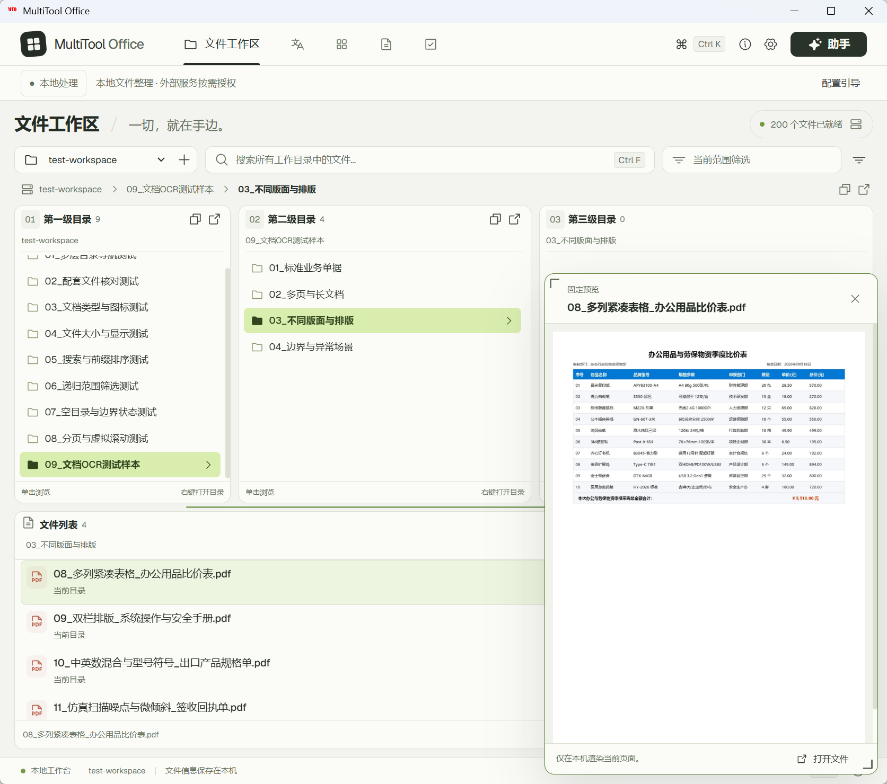
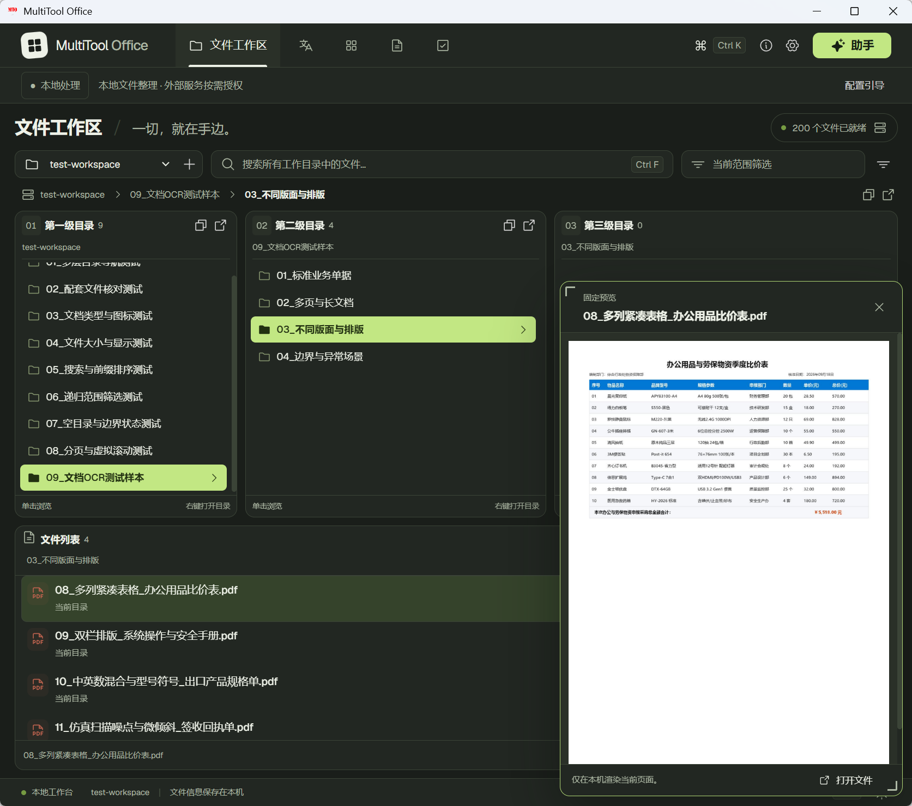
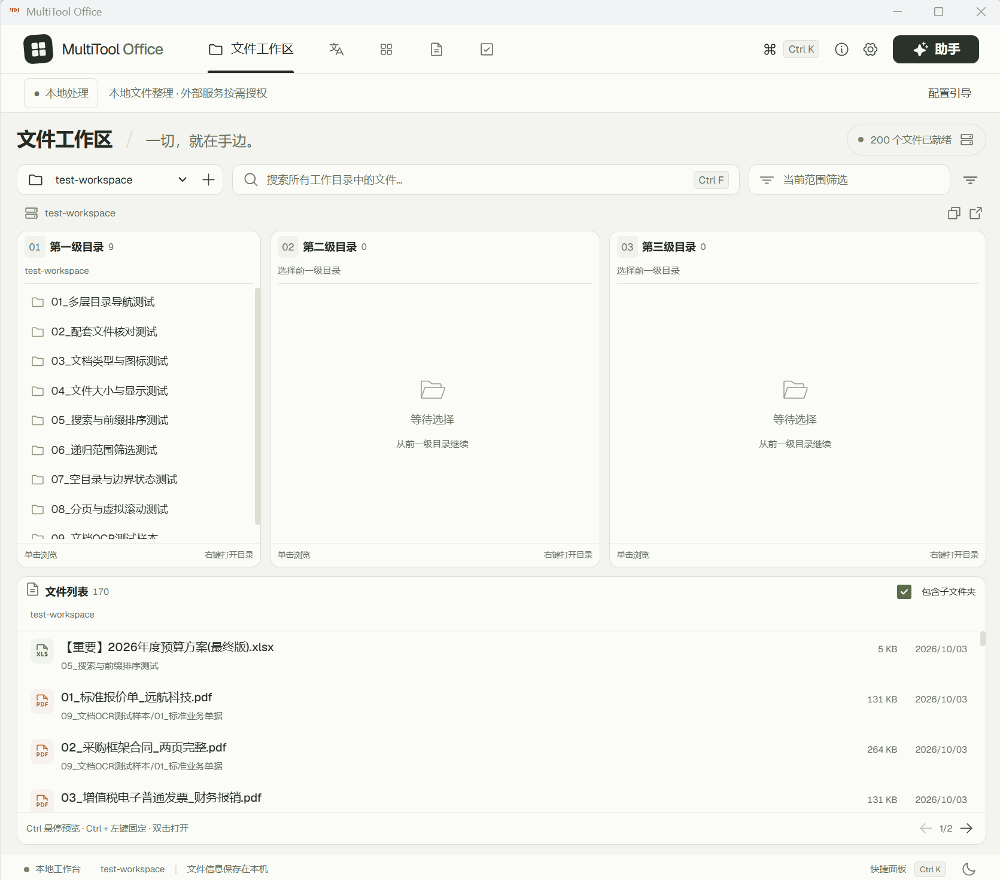
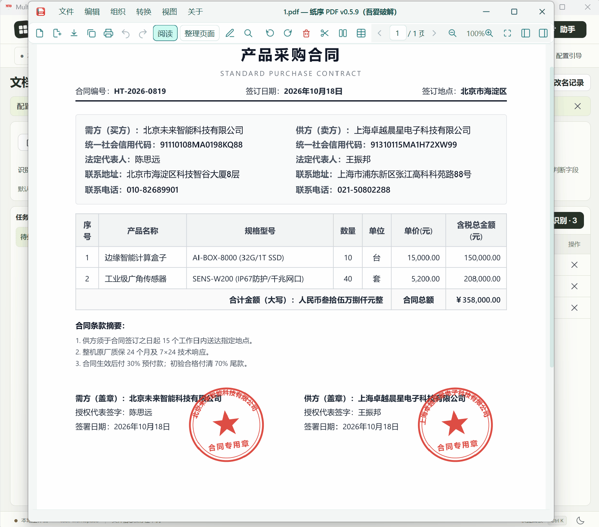
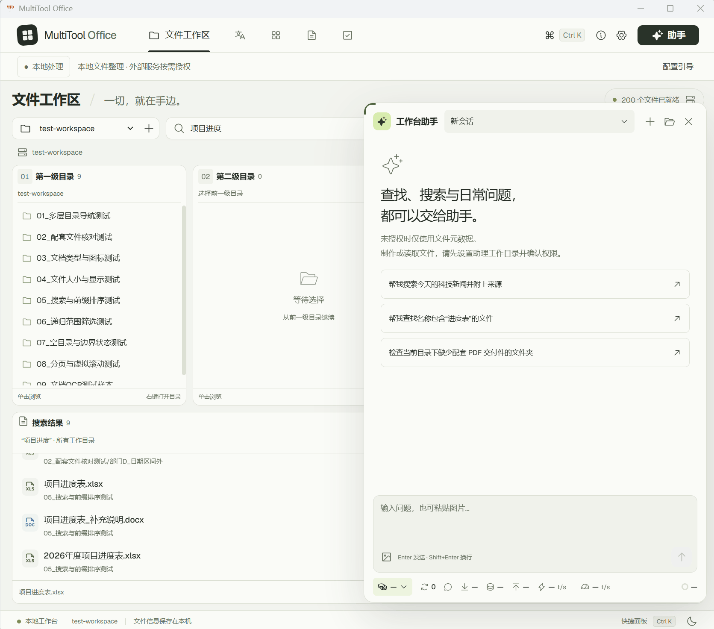
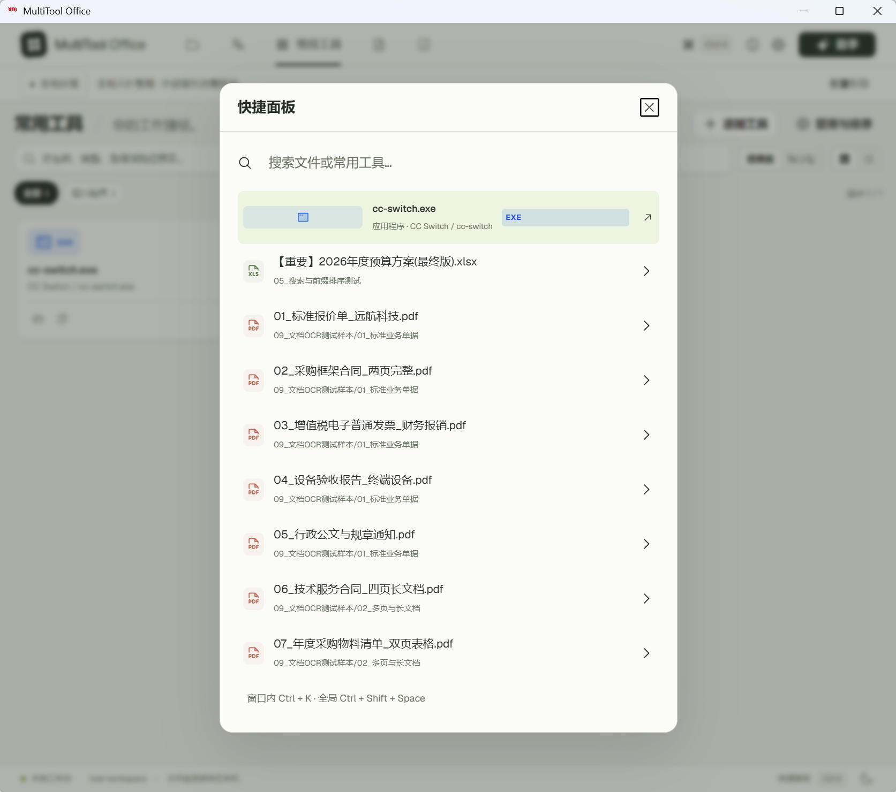
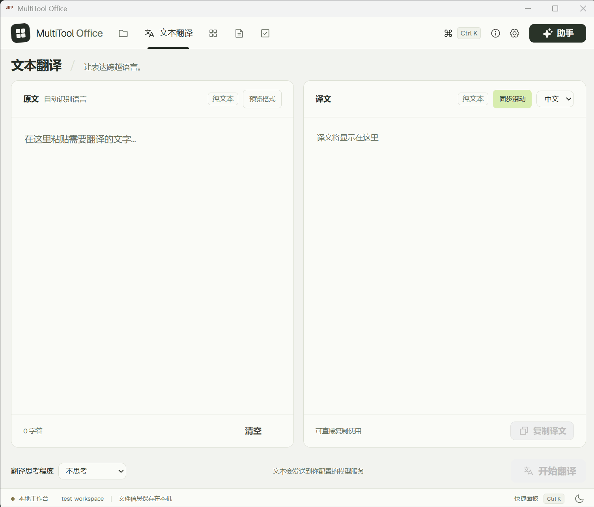
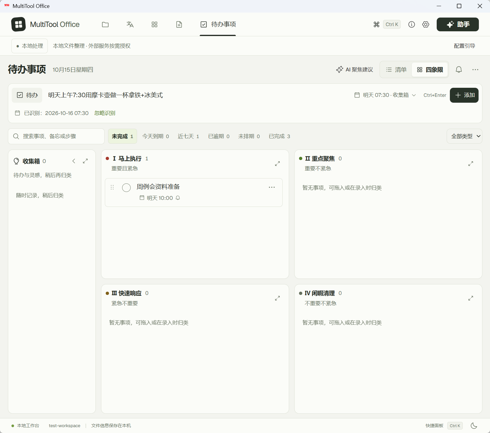

[English](README.md) | [简体中文](README.zh-CN.md)

# MultiTool Office Next

**Find files, preview documents, and rename scans in one Windows desktop app.**

MultiTool Office Next (MTO) is a free, open-source toolbox for column-based file browsing, local file search, document previews, and offline OCR batch renaming. Browsing, search, preview, and default OCR run on your PC without an app account or AI API key. An AI assistant and translation are available through services you choose to connect.

[**Download for Windows x64**](https://github.com/d8349565/MultiTool-Office-Next/releases/latest) · [Quick start](#quick-start) · [Features](#features) · [Report an issue](https://github.com/d8349565/MultiTool-Office-Next/issues)

 [](LICENSE)

**Current app and installer language: Simplified Chinese.**

## Installation

1. Open the [latest release](https://github.com/d8349565/MultiTool-Office-Next/releases/latest).
2. Download the Windows installer ending in `_x64-setup.exe` and run it. You do not need the source-code ZIP.
3. Follow the installation wizard, then open **MultiTool Office Next**.

Requires **Windows x64 and Microsoft Edge WebView2**. The installer may download WebView2 if it is missing; OCR models are bundled with the installer. The app window uses the name **MultiTool Office**.

The app is free to use. Optional model, search, and scoring services may require provider accounts and paid API access. See the release notes for what the downloadable build includes; `main` may contain newer fixes.

## Quick start

1. **Add a working folder:** in the first-run setup or File Workspace (`文件工作区`), choose `添加工作目录` and wait for local indexing. You can skip AI setup.
2. **Find a file:** press `Ctrl + F` and enter part of its filename.
3. **Check its contents:** hold `Ctrl` while hovering over a result to preview it. Double-click to open it in the default application.

You can now browse folder levels, search your selected working folders, and preview files from one window.

## Screenshots

Screenshots and GIFs come from existing app builds; some controls have changed in newer versions.

| Light mode | Dark mode |
| :---: | :---: |
|  |  |

## Features

### File browsing and local search

Keep several folder levels visible while moving through project or client folders.

- Search filenames across your configured working folders; narrow results by file extension, modification date, or path.
- Find directories at any depth by name or relative path, then select one to navigate there and limit the file results. Clear the directory condition with × while keeping your browsing position.
- Clear file-search keywords with × while retaining other filters.
- Copy names or paths, open files in their default applications, or reveal them in Windows File Explorer.

The index stores filenames, paths, and other metadata. Search does not index document body text.

<details>
<summary>Watch file browsing and search</summary>



</details>

### Local document previews

Hold `Ctrl` and hover to preview; use `Ctrl + left-click` or `Ctrl + Enter` to keep a preview open.

- Preview PDF, common image formats, text, Markdown, CSV, Word (`.docx`), and Excel (`.xlsx`).
- Turn PDF pages, switch Excel worksheets, and resize the preview window.
- Preview content stays local and is not automatically added to AI conversations. Macros, formulas, and scripts are not executed.

Word previews focus on text. Excel previews have row, column, and content limits and use cached formula values. Use the original application for complex layouts, charts, and editing.

### Offline OCR and batch renaming

Import scanned PDFs or images, extract fields such as company, date, and document number, and assemble filenames using your rules.

**Add files → match or select a profile → run the task → review the results.**

- Local OCR supports label-based extraction, regular expressions, drawn regions, and date normalization.
- Match profiles per file using first-page keywords. Ambiguous matches or low-quality text stay available for review; change the profile and retry only the affected file.
- Reuse, import, and export profiles, or ask the optional AI service to draft one for review.
- Edit extracted values, inspect their sources, export results, and retry failed or interrupted items.
- One-click tasks stop at review by default. You can save options for TXT / CSV / JSON export, rename previews, or automatic renaming. Automatic renaming requires confirmation when first enabled or when rules change; items needing review are held back.
- Renaming checks file state and naming conflicts, reports partial failures, and supports undo. Export an exceptions CSV and retry failed undo operations after resolving file locks or conflicts.

Renaming changes filenames, not document contents. Undo checks whether files have changed or their original names are already occupied. Recognition results depend on the document and profile; review names before applying them.

See the [OCR profile and example guide](ocr-samples/OCR提示词与案例使用指南.md) (Chinese) for purchase contracts, quotations, delivery notes, and other forms.

<details>
<summary>Watch OCR extraction and batch renaming</summary>



</details>

### Optional AI assistant

Connect your own model service to ask for file searches, check whether related files are missing, or prepare a document from the results. For example: “List folders that contain Contract.docx but are missing Contract.pdf.”

- Tool calls are shown as the assistant works. Public web search is optional through Tavily or DeepSeek; image questions require a vision-capable model.
- Reading document contents or creating files requires a separately authorized assistant folder and confirmation for each operation.
- Create basic TXT, Markdown, Word, Excel, PowerPoint, HTML, and PDF documents. Outputs focus on text, simple tables, and bullet slides; new files do not overwrite existing ones.
- PDF creation and local preview are supported; reading PDF body text through the assistant is not currently supported.

Extra DeepSeek page fetching is off by default and shares the task's web-request limit with search. AI, translation, and other connected services send relevant information to your chosen providers; see [Privacy and data](#privacy-and-data).

<details>
<summary>Watch the AI assistant search public information</summary>



</details>

### Everyday tools

| Tool | What you can do |
| :--- | :--- |
| Quick launcher | Press `Ctrl + K` for frequently used tools and recent files or folders. Files and folders open at their location in the app; tools launch directly. Search or remove history entries. Use `Ctrl + Shift + Space` to bring the app back from another application. |
| Translation | Submit text, Markdown, or HTML content and read the source and translation side by side. Requires a connected model service. |
| Tasks and reminders | Organize work in a quadrant or list view, add dates and steps, and restore deleted tasks. |

Tasks with a specific date and time can remind you 10 minutes before they are due. The app must remain running; closing the main window can leave it in the system tray.

<details>
<summary>See the launcher, translation, and task views</summary>







</details>

## Optional AI setup

You can reopen the setup guide from `配置引导` in the top bar or from Settings. Local file tools and default OCR work without completing this setup.

<details>
<summary>Connect a model and optional web search</summary>

1. **Model:** create an API key on the [official DeepSeek platform](https://platform.deepseek.com/api_keys), or use another OpenAI-compatible service. In `模型参数` (Model parameters), check the endpoint and model, enter the key, test and save, then choose `使用此配置` (Use this configuration). Existing configurations are retained.
2. **Web search:** in `联网与评分` (Network and scoring), select Tavily or DeepSeek. DeepSeek can reuse a saved official DeepSeek model profile or use a separate search key. Tavily requires its own key from the [Tavily platform](https://app.tavily.com/). After a successful test, enable search and choose `保存此模块` (Save this module). A successful search test does not configure an AI model.
3. **Page content and costs:** DeepSeek search uses page content when available and otherwise uses summaries. Extra page fetching is off by default. DeepSeek Search / Fetch costs are included in session costs; review their prices in `费用计价` (Pricing). See the [search and billing guide](docs/deepseek-search.md) (Chinese).

Connection tests send fixed test content, not your business files, and may incur provider charges. Invalid replacement keys do not replace existing valid keys. DeepSeek search-test costs appear in the test result and network activity. Optional Jev-assisted scoring has its own configuration.

</details>

## Keyboard shortcuts

| Shortcut | Action |
| :--- | :--- |
| `Ctrl + F` | Focus file search in File Workspace or task search in the task view |
| `Ctrl + hover` | Temporarily preview a file |
| `Ctrl + left-click` / `Ctrl + Enter` | Keep a file preview open |
| `Ctrl + K` | Toggle the quick launcher |
| `Ctrl + Shift + Space` | Bring the desktop app back and open the launcher |
| `Alt + 1` through `Alt + 5` | Switch between the main modules |
| `Esc` | Close the current dialog or preview |

## Privacy and data

| Operation | Data handling |
| :--- | :--- |
| Browsing, indexing, and file search | Local metadata processing: filenames, paths, size, and dates; document body text is not indexed. |
| Document preview | Reads limited content from the selected file locally; does not upload it or automatically include it in AI context. |
| Default OCR | Reads selected PDFs or images and extracts text locally. |
| AI assistant, translation, and AI profile drafting | Sends relevant input to the configured model service. Assistant requests can include chat history, images, role files, filenames, full paths, and document content you approved for reading. |
| Tavily / DeepSeek search and optional fetching | Sends public queries or URLs to the selected provider and passes returned material to the model. A session that has accessed local workspace material cannot continue with public search or fetching. |
| Optional Jev scoring | Sends candidate information. Sensitive numeric strings in OCR candidate lines are filtered first; this does not anonymize all translation text, chats, images, or role files. |

File-browser folders and the assistant's authorized read/create folder have separate permissions. API keys are stored in **Windows Credential Manager**. Conversations, OCR results, tasks, and generated files may remain on your PC until you clear them.

Connected features request consent on first use and when the service, account, or data scope changes. In `隐私与联网` (Privacy and network), revoke consent, enable local-only mode, or inspect activity. Local-only mode blocks application API requests while local file tools and OCR remain available.

Activity keeps metadata and DeepSeek tool-cost snapshots for up to 30 days and 1,000 entries, without additionally recording body text, full file paths, or keys. Setup progress, consent, and activity records are not transferred with exported settings.

Further details (Chinese): [Usage and data safety](USAGE_AND_PRIVACY.txt) · [Assistant folder permissions](docs/assistant-workspace-security.md) · [Release changes and manual checks](docs/next-release.md).

## Troubleshooting

- **WebView2 is missing or installation fails:** install the runtime using [Microsoft's official WebView2 download](https://developer.microsoft.com/en-us/microsoft-edge/webview2/), then run the app installer again.
- **A model or search connection test fails:** check the key, account balance, model permissions, endpoint, and network using the reported error.
- **Document formatting looks different:** previews and AI-created documents have the limits described above. Open the file in its original application for full layout and editing.

## Contributing

Bug reports, feature requests, and pull requests are welcome. When [opening an issue](https://github.com/d8349565/MultiTool-Office-Next/issues), include the app version, Windows version, and steps to reproduce. See [CHANGELOG.md](CHANGELOG.md) for release history (Chinese).

<details>
<summary>Build and run from source on Windows</summary>

The desktop app uses Tauri 2, React, TypeScript, and Rust. Development requires Windows x64, Node.js/npm, Rust, and Windows C++ build tools with the SDK. Building the OCR component requires **64-bit Python 3.12**.

```powershell
git clone https://github.com/d8349565/MultiTool-Office-Next.git
cd MultiTool-Office-Next
npm.cmd ci
npm.cmd run ocr:build
npm.cmd run desktop
```

The desktop workspace should open. Use `npm.cmd run package:keep` to create a Windows installer using the current project version. Script details: [package.json](package.json) and [Windows build script](scripts/windows.ps1).

</details>

## License

[Apache License 2.0](LICENSE). Copyright 2026 Lee; see [NOTICE](NOTICE) for attribution. Third-party dependencies, fonts, and icons retain their respective licenses.
